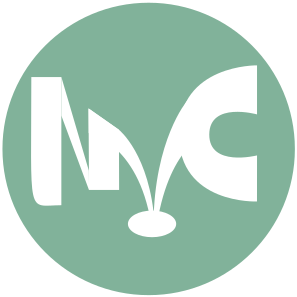

# NexoCast

<p align="center">
  
</p>

NexoCast es un puente multimedia de código abierto diseñado específicamente para dispositivos Huawei con EMUI 14+ (como la serie Pura 70). Su objetivo es permitir que cualquier reproductor de medios de terceros (YouTube Music, Poweramp, VLC, Spotify, etc.) se integre de manera nativa con la interfaz Live View (cápsula flotante) y el Centro de Control de EMUI.

## Contexto Técnico

EMUI 14 introduce la función "Live View", cuyo acceso está fuertemente restringido por una lista blanca (whitelist) a nivel de sistema operativo. Solamente las aplicaciones preaprobadas por Huawei (como su reproductor nativo o aplicaciones asociadas como Tidal) tienen los permisos necesarios para emitir su estado de reproducción, metadatos y controles hacia este componente de la interfaz. Los reproductores estándar que utilizan las APIs convencionales de Android son ignorados por el sistema de Huawei.

## Arquitectura y Funcionamiento

NexoCast elude esta restricción técnica mediante una estrategia de intermediación y suplantación de identidad (spoofing) sin requerir acceso root. El flujo de ejecución es el siguiente:

1. Suplantación de Paquete (Spoofing): La aplicación se compila utilizando el applicationId de una aplicación incluida en la lista blanca de Huawei (com.aspiro.tidal). El sistema operativo EMUI confía de manera implícita en este identificador para la delegación de la interfaz.
2. Intercepción de Medios: Mediante la implementación de un NotificationListenerService, NexoCast monitorea las notificaciones multimedia y las sesiones activas generadas por el reproductor original del usuario.
3. Clonación de Sesión: El servicio extrae en tiempo real los metadatos (título, artista, carátula) y el estado de reproducción (PlaybackState), inyectándolos en un MediaSession nativo gestionado por el puente.
4. Prevención de Cierre (Anti-Kill): Para evitar que el restrictivo gestor de batería de EMUI termine la sesión en segundo plano, NexoCast emite solicitudes transitorias de foco de audio (AUDIOFOCUS_GAIN_TRANSIENT_MAY_DUCK) que mantienen activo el flujo de medios del sistema.
5. Enrutamiento de Controles: Las acciones de transporte (Play, Pause, Next) originadas en la Live View son capturadas por NexoCast y redirigidas al controlador original. Asimismo, al interactuar con la cápsula flotante, NexoCast resuelve el intent de lanzamiento de la aplicación de origen, trayéndola a primer plano.

## Instalación y Uso

1. Requisito previo: Es indispensable desinstalar la aplicación oficial de TIDAL si se encuentra en el dispositivo, ya que Android impedirá la instalación de NexoCast debido al conflicto de firmas criptográficas en el identificador del paquete.
2. Descargue el archivo APK de la versión más reciente desde la sección de [Releases](https://github.com/Tata-fck/NexoCast/releases) del repositorio.
3. Instale la aplicación en su dispositivo Huawei.
4. Diríjase a Ajustes -> Aplicaciones -> Acceso a Notificaciones (o Acceso especial de aplicaciones).
5. Conceda el permiso de acceso a notificaciones a NexoCast.
6. Inicie cualquier reproductor de medios. La interfaz de Live View reflejará automáticamente la reproducción en curso.

## Compilación

El proyecto está estructurado de manera estándar para Android Studio, utilizando Gradle y Kotlin.

```bash
git clone https://github.com/Tata-fck/NexoCast.git
cd NexoCast
./gradlew assembleDebug
```

Nota para desarrolladores: Es imperativo mantener el applicationId definido en el archivo build.gradle.kts. Modificar este valor por uno que no se encuentre en la lista blanca de EMUI resultará en la pérdida de integración con la función Live View.

## Licencia

Este proyecto se distribuye bajo la Licencia MIT. Consulte el archivo [LICENSE](LICENSE) para obtener más detalles.
